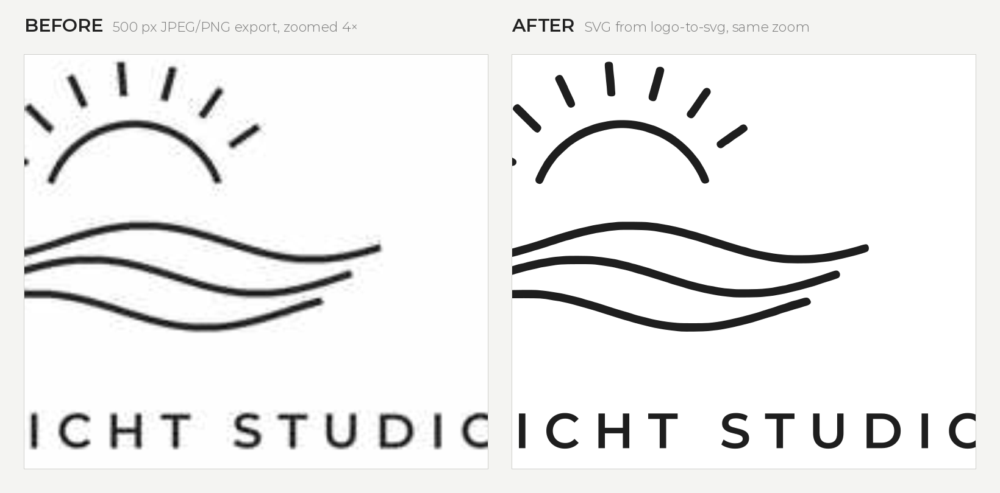

# logo-to-svg

Turn a blurry raster logo (PNG/JPG, e.g. exported from Canva or generated by AI) into a clean, scalable SVG – for free, with open-source tools only. Works as a command-line tool, a Python library and a [Claude skill](SKILL.md).

- **Graphic:** upscaled, smoothed and traced with [potrace](https://potrace.sourceforge.net/) into smooth Bézier curves.
- **Text:** re-set with a free [Fontsource](https://fontsource.org/) font (default Montserrat), letter spacing fitted to the original, converted to paths – so it renders identically everywhere.
- **Output:** one optimized SVG (viewBox only, 2-decimal precision, transparent background) plus an optional PNG preview.



<sub>Example: [`examples/before.png`](examples/before.png) → [`examples/after.svg`](examples/after.svg), created with<br>
`logo-to-svg examples/before.png -o examples/after.svg --text "NORDLICHT STUDIO" --weight 600 --text "DESIGN & PHOTOGRAPHY" --weight 300`</sub>

## Install

```bash
pipx install git+https://github.com/bernhardbrugger/logo-to-svg    # or: pip install git+https://...
```

Needs Python 3.9+. Downloading fonts automatically needs [Node.js](https://nodejs.org/) (`npm`); without it, pass a local font file with `--font`. Developed and tested on Windows. The optional PNG preview (`--preview`) needs `pip install cairosvg` and the native Cairo library; skip it if that is a hassle on your system.

## Use

```bash
logo-to-svg logo.png -o logo.svg --preview preview.png \
    --text "DR. JANE DOE" --weight 600 \
    --text "Physician"    --weight 300
```

Text lines are matched to the bottom-most horizontal bands of the image, in reading order. Everything above them is traced as the graphic. Without `--text`, everything is traced – fine for large lettering; small text (< ~12 px) breaks, and the tool warns you.

| Option | Description |
|---|---|
| `--text` | Text line to re-set (repeat, top to bottom). |
| `--weight` | Font weight per text line (default 400). |
| `--family` | Fontsource family, downloaded via npm (default Montserrat). |
| `--font` | Local font file per line, overrides `--family`. |
| `--fit` | `auto` (default), `caps` or `bounds`. ALL-CAPS lines are sized by cap height; lines with lowercase letters by ascender-to-descender height. |
| `--color` | Override the detected color. |
| `--smooth` | Blur before tracing, in source px (default 0.6). Raise to 1.0–1.5 for jagged, non-antialiased sources. |
| `--preview` | Render a PNG preview on white. |
| `--fixed-size` | Keep width/height attributes (default: responsive, viewBox only). |

As a library:

```python
from logo_to_svg import vectorize

vectorize("logo.png", "logo.svg", texts=["DR. JANE DOE"], weights=["600"])
```

## Install as a Claude skill
Copy this folder into your skills directory (e.g. `~/.claude/skills/logo-to-svg/`) or upload it as a custom skill in Claude. Then just send a logo and ask Claude to vectorize it. The skill calls `scripts/vectorize.py`, which runs straight from the folder (install the dependencies listed in [`SKILL.md`](SKILL.md) once).

## Limits
Single color · irregularities in the source carry over into the trace · the re-set font is a close match unless you supply the original with `--font` · no gradients or photos.

## Development

```bash
pip install -e ".[dev]"
pytest
```

The tests need no network, npm or system fonts: they generate a tiny test font and synthetic logos.

## License
MIT
